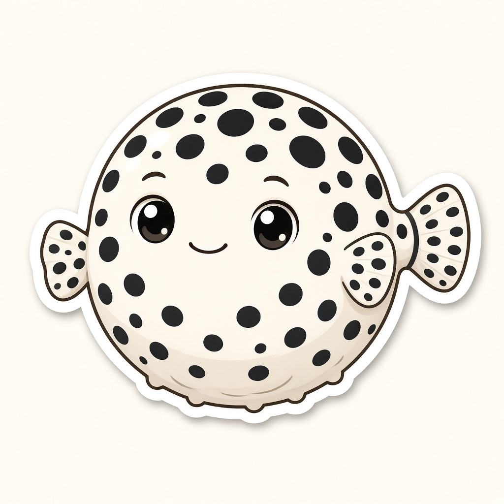

# NovaPuff



NovaPuff is a small open-source tool from Hungry Nova Labs. You use it when you send someone a demo.

It writes that person's name into the folder and saves a fingerprint of the files. When the demo starts, it checks that fingerprint. If a file was changed and the check is still there, the demo stops and a little Dalmatian pufferfish pops up. That pufferfish is the mascot.

If an unchanged folder comes back to you, NovaPuff can tell you who that copy was made for.

The person you send it to can still open the folder, run it, and read it. An AI can help them rebuild whatever those files show. NovaPuff's job is the name on the copy, and the pop when a file changes.

Leave the part you want to keep on a computer you control. The demo can show the result, or call a server you run. When the conversation itself should stay private, use a written agreement.

## Try it

You need Python 3.11 or newer.

```bash
python3 -m venv .venv
source .venv/bin/activate
pip install -e ".[dev]"

mkdir -p ~/.config/novapuff
novapuff keygen -o ~/.config/novapuff/novapuff.key
novapuff seal examples/tiny-demo --key ~/.config/novapuff/novapuff.key --recipient "Ada Lovelace"
novapuff who examples/tiny-demo --pub ~/.config/novapuff/novapuff.pub
python examples/tiny-demo/demo.py
```

The private key stays on your computer. Keep it outside the demo folder and outside git. The matching public key is how you check a copy later.

In your own demo, seal the folder first, then add this where the demo starts. `root` is the demo folder.

```python
import novapuff

novapuff.guard(root)
```

## What appears in the folder

- `NOVAPUFF.txt` says who the copy was made for, in plain text.
- `novapuff.pub` lets the demo check itself when it starts.
- `novapuff-seal.json` holds the fingerprint and the signature.

Git folders, virtual environments, and Python cache folders are left out of the fingerprint. Any other new file inside the folder makes it pop, so keep installs and build output outside the folder you send. A folder with more than 2,000 files needs `--big`.

Someone can take the check out, or stamp the folder again with their own key, and then run a changed copy. Your public key only calls a copy intact when it still matches the stamp you made.

## License

Copyright 2026 Hungry Nova Labs LLC.

NovaPuff is open source under the Apache License, Version 2.0. Hungry Nova Labs LLC keeps the copyright. Anyone may use, change, and share the code under that license. See [LICENSE](LICENSE).
